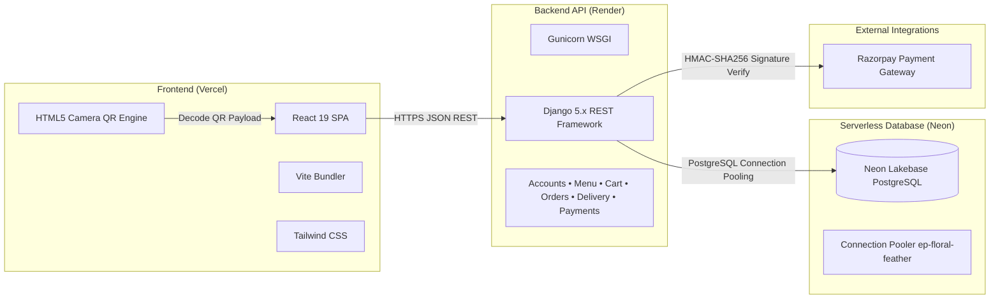

# 🍔 SmashCity — Master Presentation Script & Complete Slide/Page Guide

This is the **complete, page-by-page presentation script** for **SmashCity**. It gives you the exact words to speak, screen-by-screen navigation cues, technical architecture highlights, and a 3-way split-screen live demonstration script (Customer + Admin + Rider).

---

## Quick Navigation
1. [Executive Summary & Tech Stack](#1-executive-summary--tech-stack)
2. [Presentation Flow & Timing Overview](#2-presentation-flow--timing-overview)
3. [Page-by-Page Speaking Script](#3-page-by-page-speaking-script)
   - [Page 1: Customer Storefront (Hero & Brand Showcase)](#page-1-customer-storefront-hero--brand-showcase)
   - [Page 2: Dynamic Menu & Real-Time Inventory](#page-2-dynamic-menu--real-time-inventory)
   - [Page 3: Interactive Cart ("Smash Bag") & Coupon Engine](#page-3-interactive-cart-smash-bag--coupon-engine)
   - [Page 4: Checkout Modal & Secure Payment Gateway](#page-4-checkout-modal--secure-payment-gateway)
   - [Page 5: Live Order Tracking & Customer 4-Digit OTP](#page-5-live-order-tracking--customer-4-digit-otp)
   - [Page 6: Kitchen & Operations Admin Console (QR Dispatch)](#page-6-kitchen--operations-admin-console-qr-dispatch)
   - [Page 7: Delivery Partner / Rider Portal (Camera QR Scanner)](#page-7-delivery-partner--rider-portal-camera-qr-scanner)
   - [Page 8: Multi-Role Authentication (Customer / Rider / Admin)](#page-8-multi-role-authentication-customer--rider--admin)
4. [Live 3-Way Split-Screen Demonstration Script](#4-live-3-way-split-screen-demonstration-script)
5. [Technical Architecture & Cloud Infrastructure](#5-technical-architecture--cloud-infrastructure)
6. [Top Technical Viva / Evaluator Q&A](#6-top-technical-viva--evaluator-qa)

---

## 1. Executive Summary & Tech Stack

* **Platform Name:** SmashCity
* **Tagline:** Ultra-Fast Urban Burger Ordering Platform with QR-Code Self-Pickup Dispatch, Doorstep OTP Verification & Cloud Database
* **Frontend:** React 19, Vite, Tailwind CSS, Framer Motion, Lucide Icons, HTML5-QRCode, Canvas-Confetti
* **Backend:** Python 3.12+, Django 5.x, Django REST Framework (DRF), Gunicorn
* **Database:** Neon Serverless PostgreSQL (Cloud Lakebase Postgres with connection pooling)
* **Cloud Hosting:** Vercel (Frontend SPA) + Render (Backend Web Service)
* **Payments:** Razorpay API (HMAC-SHA256 signature verification) + Cash on Delivery (COD)
* **Security:** Server-Side Price Recalculation, UUID Idempotency Keys, Atomic Transactions (`transaction.atomic()`), Token Authentication

---

## 2. Presentation Flow & Timing Overview

| Segment | Topic | Estimated Time |
|---|---|---|
| **Intro** | Project Vision, Business Problem, & Modern Architecture | 1 min |
| **Storefront & Menu** | Hero, Category Filtering, Dynamic Stock Sync | 1.5 min |
| **Cart & Checkout** | Cart Drawer, Server-side Coupon Engine, Razorpay & COD | 1.5 min |
| **Live Tracking & OTP** | 6-Stage Timeline, Secret 4-Digit Verification OTP | 1 min |
| **Kitchen Operations** | Live Admin Console, Pipeline Advance, Dynamic QR Dispatch | 1.5 min |
| **Delivery Rider Portal**| Live Camera Scanner, Route Navigation, Doorstep OTP Verification | 1.5 min |
| **Live 3-Way Demo** | End-to-end interactive demo across 3 windows | 2 - 3 min |
| **Architecture & Q&A** | Neon Postgres, Render/Vercel CI/CD, Technical Viva | 2 min |
| **Total** | | **~10 - 12 mins** |

---

## 3. Page-by-Page Speaking Script

---

### Page 1: Customer Storefront (Hero & Brand Showcase)
* **URL:** `http://localhost:5173/` or your Vercel URL
* **Screen Focus:** Navigation Bar, Hero Section, Animated Marquee, "Why SmashCity" Badges.

#### 🎙️ What to Say:
> *"Good morning/afternoon, professors and evaluators. Today, I am proud to present **SmashCity**, an enterprise-grade full-stack food ordering, kitchen dispatch, and live delivery platform.*
>
> *When you look at our storefront, the first thing you notice is high-impact, cinematic branding. Built with **React 19** and styled with **Tailwind CSS**, the interface combines modern dark aesthetic, fluid typography, and micro-animations powered by **Framer Motion**.*
>
> *In the header, we have an adaptive navigation system: it instantly detects the user's role—whether they are a hungry customer, a delivery rider, or an operations manager—and displays the appropriate navigation links and status badges.*
>
> *As we scroll down the hero section, the page highlights our core value propositions: ultra-fast 25-minute delivery, freshly smashed patties with crispy lace edges, and 100% certified halal chicken. Notice how smooth the interactions feel without any page refresh or layout jitter."*

---

### Page 2: Dynamic Menu & Real-Time Inventory
* **URL:** `http://localhost:5173/#menu`
* **Screen Focus:** Category tabs (Burgers, Sides, Sauces, Beverages), Search bar, Diet badges, "Sold Out" indicators.

#### 🎙️ What to Say:
> *"Moving to our **Dynamic Menu section**, every category, product description, price, and image is queried directly from our **Django REST Framework** backend via our `/api/menu/products/` endpoint.*
>
> *Customers can filter through categories—Burgers, Sides, Sauces, and Beverages—with instant client-side tab switching. Notice the real-time search and diet badges highlighting vegetarian or signature items.*
>
> *Crucially, our menu is connected to real-time inventory. If a kitchen manager marks an item as 'Sold Out' in the Admin Console, the item card immediately displays a distinct 'Sold Out' badge and disables the 'Add to Bag' button, preventing customers from ordering unavailable food. This solves one of the biggest friction points in modern restaurant operations."*

---

### Page 3: Interactive Cart ("Smash Bag") & Coupon Engine
* **URL:** Click the Cart icon (<kbd>ShoppingBag</kbd>) in the top-right navbar.
* **Screen Focus:** Slide-out drawer, quantity counters, coupon code box, free delivery progress bar.

#### 🎙️ What to Say:
> *"When a customer clicks 'Add to Order', the **Smash Bag** slide-out drawer smoothly opens from the right.*
>
> *Let's highlight two key engineering practices here:*
> 1. *First, **Persistent State**: The cart seamlessly manages both guest sessions and authenticated users. Guest sessions use a persistent guest key in local storage, so if a customer refreshes the page or comes back later, their selected items are safely preserved.*
> 2. *Second, **Server-Side Coupon Engine**: Watch what happens when I enter the promotional coupon code `SMASH10` and click 'Apply'. The frontend does not calculate the discount! Instead, it sends an API request to `/api/orders/validate-coupon/`. The Django backend verifies that the coupon is active, checks the minimum order spend threshold, and calculates the exact discount amount server-side. If I enter `SMASH20`, it calculates a 20% discount on orders above $30.*
>
> *We also have a dynamic delivery fee bar encouraging customers to add one more item to qualify for priority delivery."*

---

### Page 4: Checkout Modal & Secure Payment Gateway
* **URL:** Click 'Proceed to Checkout' inside the Smash Bag drawer.
* **Screen Focus:** Customer name, phone, address fields, Payment Mode toggle (Cash on Delivery vs Razorpay Online Payment).

#### 🎙️ What to Say:
> *"Clicking 'Proceed to Checkout' opens our streamlined checkout modal.*
>
> *Here, customers enter their delivery address and contact details. For logged-in users, previously saved delivery addresses from their profile address book are auto-populated.*
>
> *Now, let's look at the financial engineering:*
> - *SmashCity implements **Zero-Trust Client Pricing**. The frontend never sends total dollar amounts to the backend. It only sends product IDs and quantities. The Django backend queries the database for active prices, recalculates subtotals, tax, and delivery fees, and validates coupon rules on the server.*
> - *To protect against accidental double-clicks or unstable mobile networks, the checkout process generates a unique **UUID Idempotency Key**. If duplicate requests arrive, the backend safely recognizes the key and returns the existing order instead of double-billing.*
> - *For payments, we offer dual options: **Cash on Delivery (COD)**, and **Razorpay Online Payment**. For Razorpay, the backend creates an authorized order with currency subunits and verifies the cryptographic **HMAC-SHA256 signature** before confirming payment status.*
>
> *Let's select 'Cash on Delivery' and click 'Confirm & Place Order'."*

---

### Page 5: Live Order Tracking & Customer 4-Digit OTP
* **URL:** Order placed screen / Click 'Track Order' or header tracker.
* **Screen Focus:** 6-stage vertical/horizontal stepper, **Prominent 4-digit Delivery OTP Badge**, delivery address, assigned rider card, live status history log.

#### 🎙️ What to Say:
> *"Immediately upon placing the order, the customer is presented with our **Live Order Tracking Screen**.*
>
> *Here is the centerpiece of our customer security:*
> - *Notice this bright amber badge displaying the **Secret 4-Digit Delivery OTP**—in this case, code `8492`.*
> - *The instruction explicitly informs the customer: **'Share this code ONLY with your delivery partner at your doorstep to verify handover.'** This completely eliminates fake deliveries, wrong drop-offs, and driver fraud.*
> - *Below the OTP, customers see the **Live 6-Stage Delivery Pipeline**: `Order Placed` ➔ `Confirmed` ➔ `Preparing` ➔ `Ready for Pickup` ➔ `Out for Delivery` ➔ `Delivered`.*
> - *The modal uses lightweight reactive polling against `/api/delivery/<order_number>/`. As the kitchen and rider update the order status, this tracker advances in real time without the customer having to refresh the page."*

---

### Page 6: Kitchen & Operations Admin Console (QR Dispatch)
* **URL:** Click 'Staff / Operations' in header or navigate to `/admin` in the React app.
* **Screen Focus:** Operations Dashboard, Revenue KPI cards, Order status transition buttons (`Confirm`, `Prepare`, `Ready for Pickup`), **Dispatch QR Code button and modal**, Menu & Inventory Manager.

#### 🎙️ What to Say:
> *"Now let's switch perspectives to the restaurant's operational nerve center: the **SmashCity Admin & Kitchen Console**.*
>
> *This is a purpose-built React operations console designed for kitchen tablets and managers:*
> 1. *At the top, managers have real-time KPI metrics: Today's Revenue, Active Kitchen Orders, Dispatch Rate, and Menu Items in Stock.*
> 2. *Below, incoming orders appear in an interactive pipeline. Kitchen staff can advance an order from 'Placed' to 'Preparing' with one tap on the orange **Prepare** button.*
> 3. *When the kitchen finishes grilling the burger and packaging the fries, they tap **Ready for Pickup**.*
>
> *Now, notice our signature feature: **The QR Code Dispatch System**.*
> - *Instead of cumbersome manual assignment dropdowns, managers simply click the yellow **'Dispatch QR'** button.*
> - *A large, high-contrast QR code is generated on the kitchen screen, complete with order number, item count, and a print ticket button.*
> - *The screen displays a live pulse listener: **'Waiting for rider to scan...'** As soon as an arriving courier scans this code, the modal automatically turns green and confirms the rider's name and phone in real time!"*

---

### Page 7: Delivery Partner / Rider Portal (Camera QR Scanner)
* **URL:** Click 'Delivery Rider' in the header or log in as `rider` (`/delivery`).
* **Screen Focus:** Rider header with active profile, KPI badges (Active Deliveries, Today's Earnings), **'Scan Pickup QR' button**, Camera Scanner modal with laser crosshair, Active delivery card with Google Maps link, and **Customer OTP Verification Modal**.

#### 🎙️ What to Say:
> *"Now let's look at the third pillar of SmashCity: the **Delivery Rider Portal**.*
>
> *Designed specifically for mobile couriers on bikes or scooters:*
> 1. *The rider logs in with their credentials—for example, rider **Alex Swift**.*
> 2. *When the rider arrives at the restaurant kitchen, they tap the yellow **'Scan Pickup QR'** button.*
> 3. *This opens our integrated **HTML5 Camera Scanner**. It turns on the device camera, displays a precision laser targeting crosshair, and when it aligns with the kitchen's QR code on the admin screen, it plays an **audio chime** using the Web Audio API!*
> 4. *The order is instantly claimed by the rider. Our backend concurrency safeguards ensure that an order cannot be double-claimed by two riders.*
> 5. *The order automatically transitions to **Out for Delivery**, and the rider's screen switches to the active delivery route with customer address, direct one-tap **Google Maps Navigation**, and one-tap **Phone Call**.*
>
> *When the rider arrives at the customer's doorstep:*
> - *The rider taps **'Verify Delivery OTP'**.*
> - *A 4-box OTP input drawer opens with auto-focus and auto-advance.*
> - *The rider asks the customer for their 4-digit code. If the rider enters the wrong code, the backend rejects it with an error. When the correct code is entered, the order transitions to **Delivered**, celebratory confetti bursts on screen, and COD payment is marked as PAID!"*

---

### Page 8: Multi-Role Authentication (Customer / Rider / Admin)
* **URL:** Click 'Sign In' in navbar.
* **Screen Focus:** Role Switcher pills (`Customer`, `Delivery`, `Admin`), One-click Demo Auto-Fill helpers.

#### 🎙️ What to Say:
> *"To tie the entire ecosystem together seamlessly, SmashCity features a unified **Role-Based Authentication System**.*
>
> *In our authentication modal, users can select their intended portal with dedicated tabs:*
> - * **Customer**: Allows ordering, managing saved delivery addresses, and tracking past order history.*
> - * **Delivery Rider**: Pre-configured with demo courier credentials (`rider` / `rider123`), automatically routing to the mobile delivery dashboard.*
> - * **Admin & Kitchen Operations**: Pre-configured with manager credentials (`admin` / `admin123`), granting access to the kitchen pipeline and menu management.*
>
> *Authentication uses token-based REST communication with the backend, securely storing credentials in session memory and local storage with role-based route guards."*

---

## 4. Live 3-Way Split-Screen Demonstration Script

To deliver an unforgettable presentation, open **three browser windows side-by-side** on your screen:
1. **Window A (Left):** Customer Storefront (`http://localhost:5173/`)
2. **Window B (Middle):** Kitchen Admin Console (`http://localhost:5173/` logged in as `admin`, viewing `/admin`)
3. **Window C (Right):** Delivery Rider Portal (`http://localhost:5173/` logged in as `rider`, viewing `/delivery`)

---

### Step-by-Step Live Demo Action Chart

| Step | Window | Action | What to Say (Verbatim) |
|---|---|---|---|
| **1** | **Left (Customer)** | Add **The Classic Smash** & **Crispy Fries** to cart. Apply coupon `SMASH10`. | *"I am adding a burger and fries to my bag. I apply promo code `SMASH10`—the server validates it and discounts 10%."* |
| **2** | **Left (Customer)** | Click Checkout, select COD, click **'Confirm & Place Order'**. | *"I submit the order. An atomic transaction creates the order with unique number `SC-XXXX` and generates a secret 4-digit OTP: `8492`."* |
| **3** | **Middle (Kitchen)** | Point to the order card appearing in the kitchen queue. Tap **'Preparing'**, then **'Ready for Pickup'**. | *"Notice the kitchen console immediately detects the new order. Kitchen staff click 'Preparing', then 'Ready for Pickup'. Look at the customer screen on the left—it advances automatically!"* |
| **4** | **Middle (Kitchen)** | Click **'Dispatch QR'** button. | *"Now the kitchen displays the pickup QR code on the counter terminal for incoming couriers."* |
| **5** | **Right (Rider)** | Click **'Scan Pickup QR'** ➔ Click the **1-Click Test Simulation chip** for the order (or point camera at QR). | *"Rider Alex Swift arrives at the counter, opens the scanner, and scans the kitchen QR code. Notice the audio chime!"* |
| **6** | **Middle (Kitchen)** | Point to the green notification banner on the kitchen terminal. | *"The kitchen screen turns green instantly with: 'Claimed by Alex Swift (+1 555-8391)'!"* |
| **7** | **Right (Rider)** | Click **'Verify Delivery OTP'** on the active delivery card. Enter `8492`. | *"The rider reaches the customer's house, asks the customer for their OTP, enters `8492`, and taps 'Confirm Delivery'."* |
| **8** | **All Windows** | Point to the confetti and status update on all 3 screens. | *"The delivery is verified! The customer tracker shows 'Delivered', the rider earns their delivery fee, and the kitchen logs the completed ticket. The entire loop is complete!"* |

---

## 5. Technical Architecture & Cloud Infrastructure

### Architecture Diagram

### Key Technical Talking Points:
1. **Neon Serverless PostgreSQL:**
   - Powered by **Neon Lakebase Postgres** with autoscaling and connection pooling.
   - Cloud database with unpooled and pooled endpoints (`channel_binding=require&sslmode=require`).
   - Ensures persistent customer records, order histories, and rider metrics across all instances.
2. **Render & Vercel Production Deployment:**
   - **Backend on Render:** Python 3.12 with Gunicorn, dynamic `$PORT` binding, dual URL routing (`/api/<endpoint>/` and `/<endpoint>/`), and root health-check endpoints.
   - **Frontend on Vercel:** Ultra-fast CDN distribution with SPA routing rewrite rules (`vercel.json`) to prevent 404s on browser reloads.
3. **Database Concurrency & ACID Safety:**
   - All order creation and stock decrements are encapsulated within `django.db.transaction.atomic()`.
   - Concurrency safeguards prevent multiple couriers from claiming the same order simultaneously.

---

## 6. Top Technical Viva / Evaluator Q&A

### Q1: What makes SmashCity different from a basic tutorial food app?
> **Answer:** *"Most tutorial apps are simple frontend mockups with static JSON or vulnerable backends that accept price calculations from the client. SmashCity is engineered as a production-grade system:
> 1. It implements **Zero-Trust Server-Side Pricing** and **UUID Idempotency Keys** to prevent duplicate orders and client tampering.
> 2. It features an automated **QR Code Dispatch System** where couriers scan orders with live camera targeting to claim deliveries.
> 3. It enforces **Doorstep 4-Digit OTP Verification** to guarantee physical custody handover.
> 4. It uses a serverless cloud database on **Neon PostgreSQL** and is deployed live on **Render and Vercel**."*

### Q2: How does the QR code dispatch system work under the hood?
> **Answer:** *"When an order enters 'Ready for Pickup', the Admin Console uses the `qrcode` library to render a dynamic 2D barcode containing the unique order identifier (`SC-YYYYMMDD-XXXX`). The Delivery Partner Portal uses `html5-qrcode` to access the device's camera stream via WebRTC. When the scanner identifies the barcode pattern, it extracts the order number and triggers an atomic `POST /api/delivery/<order_number>/pickup/` request containing the authenticated rider's name and phone. The backend verifies that the order is not already claimed, assigns the rider, transitions the status to `OUT_FOR_DELIVERY`, and logs an audit history entry."*

### Q3: Why is the 4-digit OTP generated on the server instead of the frontend?
> **Answer:** *"The delivery OTP is a security credential. In `Order.save()`, the Django model uses Python's cryptographic random generator `str(random.randint(1000, 9999))` to create the OTP upon order placement. It is stored directly in the database row. The rider's application does not know the OTP in advance; only the customer's authenticated tracking screen displays it. When the rider submits the OTP at the doorstep, the backend performs an exact match validation before allowing the status transition to `DELIVERED`."*

### Q4: How do you handle database concurrency if two delivery riders scan the same QR code at once?
> **Answer:** *"In `DeliveryPartnerPickupView`, we perform a concurrency check: if an order is already marked `OUT_FOR_DELIVERY` and has an `assigned_delivery_partner`, any subsequent claim request from a different rider is rejected with an HTTP 400 error: 'Order has already been claimed by [Rider Name]'. If the same rider re-scans their own order, the backend gracefully returns the order details without duplicating records."*

### Q5: How is payment verified securely with Razorpay?
> **Answer:** *"Payment verification uses a 2-step challenge-response mechanism. First, the backend creates an order using Razorpay's API and returns a unique `order_id`. Second, once the customer completes payment in the Razorpay modal, Razorpay returns a cryptographic signature. The backend independently generates an HMAC-SHA256 hash using our secret key and the concatenated string `order_id + '|' + payment_id`. If the calculated hash matches the signature from the client, the transaction is authentic and marked as `PAID`."*

---

## 7. Presentation Closing Statement

> *"To conclude: SmashCity is not just a digital menu. It is an end-to-end operational platform that harmonizes customer experience, kitchen workflow, and courier logistics through modern web standards, serverless cloud databases, and cryptographic security.*
>
> *Thank you very much for your time and attention. I am now ready to take any questions!"*
